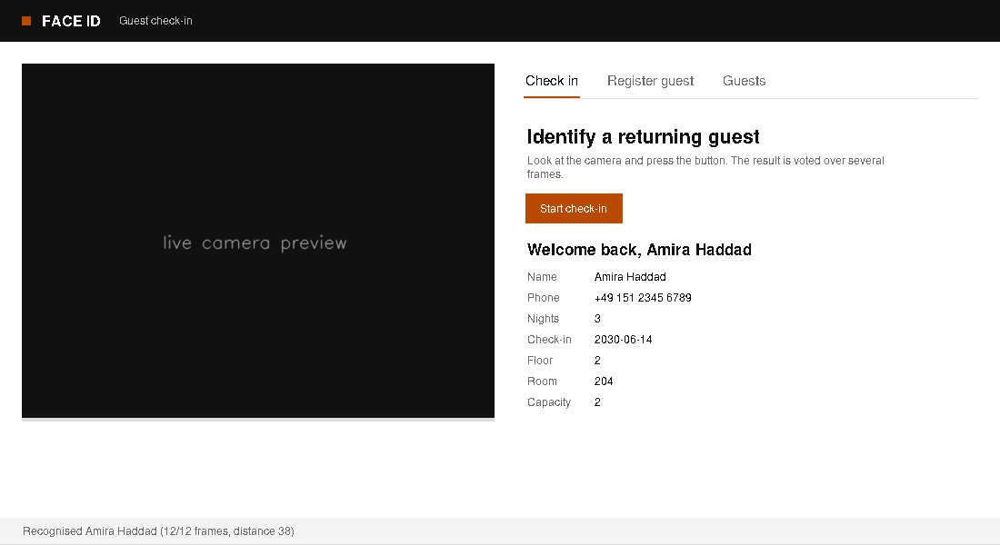

# Face ID

Guest check-in with a webcam. Register a guest's details and face once; later, recognise them and pull up
their reservation. Runs offline on the CPU, and everything is stored in one local folder.



## Run

```bash
conda env create -f environment.yml
conda activate face-id
pip install -e .
faceid
```

## Use

- **Register guest**: fill in the form, press *Save and capture face*, look at the camera for a few seconds.
  The model trains automatically.
- **Check in**: press *Start check-in*. The guest's reservation appears, or "Not recognised".
- **Guests**: list, delete (record and face samples), retrain.

Data is saved in `./data` (override with `FACEID_HOME` or `faceid --home PATH`).

## How it works

Haar cascade finds the largest face, LBPH compares it to the enrolled samples, and a distance threshold with
a vote over about 12 frames decides between a guest and "unknown".

About 8 ms per frame on a laptop CPU, and about 25 ms with 100 guests enrolled. Accuracy on the bundled
sample is perfect but the sample is tiny; see [benchmarks](docs/BENCHMARKS.md) before trusting it.

## Limits

This is a lookup aid, not a security control: there is no anti-spoofing, so a photo can fool it. Face images
are biometric data, so get consent and follow local law. More in [docs/PRIVACY.md](docs/PRIVACY.md).

## Docs

- [User guide](docs/USER_GUIDE.md): daily use, data folder, troubleshooting
- [Reference](docs/REFERENCE.md): command line, Python API, settings, project layout, development
- [Architecture](docs/ARCHITECTURE.md): modules, decision logic, what changed from the first version
- [Benchmarks](docs/BENCHMARKS.md): speed, scaling, accuracy and caveats
- [Privacy and limits](docs/PRIVACY.md)

Tests: `pytest` (UI tests skip without a display).
