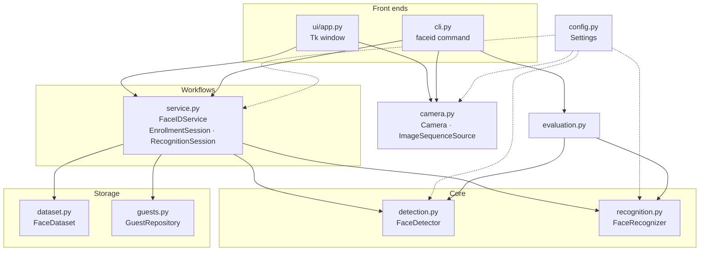

# Architecture

Face ID is a thin pipeline with storage on each side and two front ends (Tk app, CLI) on top.



Dependencies only point downwards: the core never imports the UI, and the service never touches Tk or a
real camera, which is why the whole thing is testable with recorded frames.

## Modules

| Module | Responsibility | Key decisions |
|---|---|---|
| `config.py` | Frozen `Settings` dataclass; storage paths derived from one `home` folder | No magic numbers elsewhere. `FACEID_HOME` relocates all state. |
| `camera.py` | `Camera` (OpenCV), `open_camera` (probe indices), `ImageSequenceSource` | `read()` returns `None` instead of raising on a bad frame. Probing skips Linux metadata nodes that open but never deliver frames. |
| `detection.py` | Haar detection, crop + resize | Detects on a ≤ 480 px copy, scales boxes back. Returns faces largest-first. |
| `recognition.py` | LBPH wrapper | CLAHE in `preprocess`, used identically for train and predict. `decide()` is pure and unit-tested in isolation. |
| `dataset.py` | `user.<id>.<n>.png` store | Lossless PNG (JPEG artefacts perturb LBP codes). Sample numbering survives gaps. Reads legacy `.jpg` too. |
| `guests.py` | `Guest`, validation, CSV repo | IDs = `max+1` (not row count). Temp-file + `os.replace` writes. Legacy column names accepted. |
| `service.py` | Orchestration | Sessions are *incremental* (`feed(frame)`), so a GUI can drive them from a timer and the CLI/tests from a loop. |
| `evaluation.py` | Cross-validation, FAR/TAR, timers | Same code powers `faceid evaluate`, `faceid benchmark` and the performance tests. |
| `ui/app.py` | Tk window | One `tick()` per 33 ms: run finished jobs, read frame, advance mode. Modes: `PREVIEW`, `ENROLL`, `TRAINING`, `RECOGNIZE`. |
| `ui/video.py` | Draw boxes, encode frames | Frames are handed to Tk as binary PPM (no PNG encode, no ImageTk dependency). |

## Recognition decision

For each frame LBPH returns the nearest enrolled sample's label and a **distance** (lower = closer).

```
accepted = [p for p in predictions if p.distance <= confidence_threshold]
winner   = most common label in accepted
known    = winner has >= min_votes * len(predictions)
```

* The threshold (65) was chosen from the gap between genuine and impostor distance distributions; see
  [BENCHMARKS.md](BENCHMARKS.md).
* Denominator is **all** frames, so a stranger who scores below the threshold on a couple of lucky frames
  still isn't accepted.
* Training uses every stored sample, so recognition cost grows linearly with enrolled samples
  (about 25 ms at 2 000 samples).

## UI concurrency

Tk is single-threaded. The camera loop runs on Tk's `after` timer. The only background work is model
training: a daemon thread runs it and posts a closure to a `queue.Queue`; `tick()` drains the queue on the UI
thread, so no widget is ever touched off-thread. Buttons are disabled while a mode other than `PREVIEW` is active.

## Testing strategy

| Layer | Where | What it proves |
|---|---|---|
| Unit | `test_guests`, `test_dataset`, `test_detection`, `test_recognition`, `test_camera`, `test_video` | Validation, ID rules, atomic writes, coordinate mapping, voting maths |
| Workflow | `test_service`, `test_cli` | Register → enrol → train → identify; strangers rejected; persistence across restarts; delete + retrain; regressions from v0 |
| UI | `tests/ui/` | Real Tk widgets driven by a scripted camera: form errors, full registration, cancel/rollback, timeout, check-in known/unknown/no-face, delete, failure reporting |
| Performance | `test_performance.py`, `evaluation.py` | Latency budgets, scaling, and accuracy at the shipped threshold |

Test frames are the bundled face crops pasted on a plain canvas (only ones the detector finds are used).
UI tests skip themselves when no display is available.

## What changed from v0

| v0 behaviour | Problem | Now |
|---|---|---|
| `cv2.VideoCapture(1)` hard-coded, opened in the constructor | Crashes without that exact camera, even to browse guests | Probe indices; app starts without a camera and offers *Retry* |
| `detect()` returns the most common label, never "unknown" | Every stranger is identified as somebody; `guest` unbound if no CSV row matched | Distance threshold + voting; explicit unknown result |
| `detect()` loops until 20 faces seen, no timeout, `ret` unchecked | Hangs forever if nobody is in view; crashes on a dropped frame | Timeout, `None` frames skipped |
| Blocking `cv2.imshow` loops inside the Tk callbacks | Window freezes during capture and check-in | Live preview embedded in the window, timer-driven |
| Three buttons: Submit, Capture Face, "Click before Exit" | Capturing before submitting used ID 0; forgetting to train left the model stale | One flow: validate → save → capture → train |
| ID = number of CSV lines | Duplicate IDs after any deletion; wrong ID if the CSV had a trailing blank line | `max(id)+1`, atomic writes |
| No validation | Free-text everywhere | Per-field validation with inline messages |
| First detected face, raw crops of varying size, JPEG | Picks arbitrary face; histograms depend on crop size | Largest face, fixed 160×160, CLAHE, PNG |
| Hard-coded relative paths (`Data.csv`, `dataset/`) | Breaks when run from another folder | Everything under one configurable `home` |
| Committed `__pycache__`, `.idea`, a 6.9 MB trained model, an empty `.xlsx`, a copy of the Haar XML | Repo noise | Removed / git-ignored; the cascade ships with OpenCV |

Legacy data: `Date_R` values the new parser doesn't recognise (anything other than `YYYY-MM-DD`,
`DD/MM/YYYY`, `DD-MM-YYYY`, `DD.MM.YYYY`) are read as `0001-01-01`; fix them in the CSV.
